# Quercus_analysis


``` r
library(arrow)
library(tidyverse)
dir.create("plots", showWarnings = FALSE)
```

The objective of this analysis is to characterise how the correlation
between detrended ring-width series of *Quercus petraea* (QUPE) and
*Quercus robur* (QURO) decays with the geographic distance between ITRDB
sites, and to invert that relationship to estimate the likely distance
between two series from their observed correlation.

``` r
study <- read_parquet("data/itrdb_study.parquet")
```

## Focus on Quercus

The data in `data/` contain only the ITRDB sites of two oak species:
*Quercus petraea* (QUPE, syn. *Q. sessiliflora*; 57 sites) and *Quercus
robur* (QURO; 125 sites). No further species selection is needed.

``` r
library(tmap)
library(sf)
library(rnaturalearth)

quercus_geo <- study %>%
  st_as_sf(coords = c("longitude", "latitude"), crs = 4326)

eurasia <- ne_countries(scale = "medium", returnclass = "sf")

quercus_map <- tm_shape(eurasia, bbox = st_bbox(quercus_geo)) +
  tm_polygons() +
  tm_shape(quercus_geo) +
  tm_dots(col = "species", size = 0.5, title = "Species") +
  tm_layout(main.title = "Quercus Studies in Eurasia")

quercus_map
```

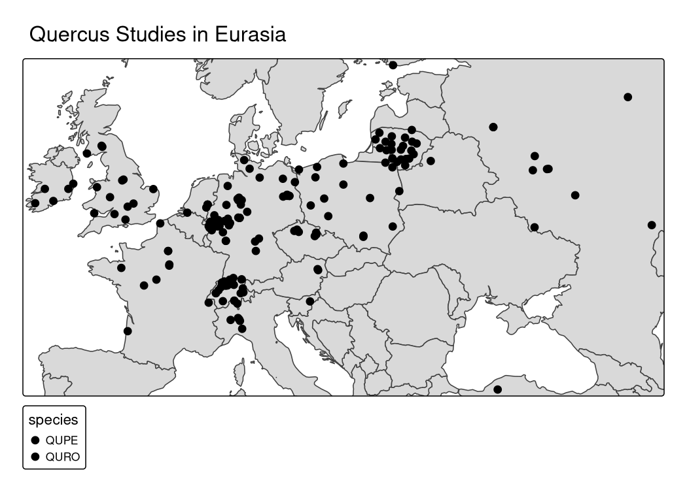

``` r
tmap_save(quercus_map, "plots/quercus_map.png", width = 9, height = 5, units = "in", dpi = 150)
```

``` r
quercus_measurements <- open_dataset("data/itrdb_measurements.parquet") %>%
  collect() %>%
  filter(raw_width > 0)
```

``` r
quercus_measurements %>%
  left_join(study %>% select(itrdb_code, latitude), by = "itrdb_code") %>%
  ggplot() +
  geom_line(aes(x = year, y = raw_width,
                group = sample_id, color = latitude),
            lwd = 0.1, alpha = 0.5) +
  scale_y_log10() +
  scale_color_viridis_c() +
  facet_wrap(~species) +
  theme_bw()
```

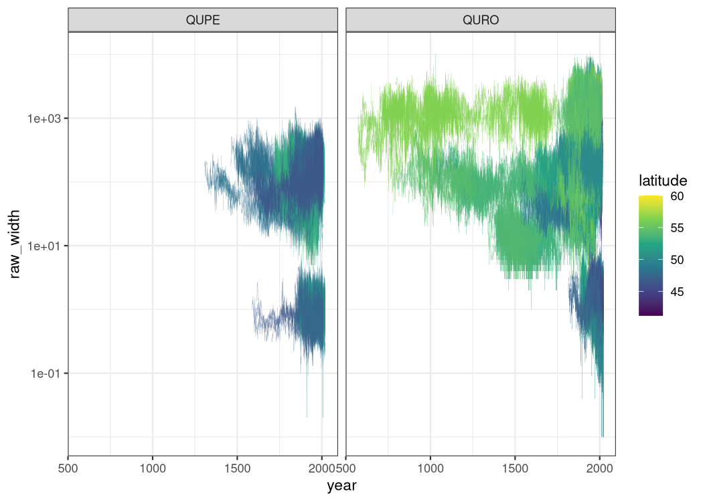

## Why scale correction is not needed

ITRDB measurements are reported in inconsistent units — some studies use
mm, others 0.01 mm or 0.001 mm. A naïve approach would be to detect the
unit and multiply by the appropriate factor before any further analysis.
However, for both the correlation analysis and the embedding analysis
carried out here, **scale correction has no effect** and can be omitted
entirely.

The reason is algebraic. Log-spline detrending computes the Tree Ring
Index as:

$$\text{TRI} = \exp\!\bigl(\log(x) - \text{spline}(\log(x))\bigr)$$

If $x$ is mismeasured by a multiplicative constant $c$ (i.e., the stored
value is $cx$ instead of $x$), the detrended result is:

$$\exp\!\bigl(\log(cx) - \text{spline}(\log(cx))\bigr) = \exp\!\bigl(\log(c) + \log(x) - \log(c) - \text{spline}(\log(x))\bigr) = \text{TRI}$$

The constant $\log(c)$ shifts the series and its spline fit by the same
amount, so it cancels exactly. The TRI — and therefore any Pearson
correlation computed from it — is **identical regardless of which unit
the raw measurements are in**.

``` r
library(dplR)
library(data.table)

setDT(quercus_measurements)
setorder(quercus_measurements, global_id, year)

# Detrend in log space: fit the spline on log(raw_width), subtract, exponentiate.
# exp() guarantees the trend is always positive (no fallback-to-Mean warning),
# and the result is still a standard TRI = raw / trend.
# ffcsaps is dplR's internal spline engine; nyrs = 2/3 * n is the ITRDB standard
# 50% frequency-response cutoff.
detrend_log_spline <- function(x) {
  valid <- x > 0 & !is.na(x)
  if (sum(valid) < 10) return(rep(NA_real_, length(x)))
  lx <- ifelse(valid, log(x), NA_real_)
  nyrs <- max(10L, floor(sum(valid) * 2L / 3L))
  trend_log <- dplR::caps(lx, nyrs = nyrs)
  exp(lx - trend_log)
}

quercus_measurements[, detrended_width := detrend_log_spline(raw_width), by = global_id]
```

``` r
quercus_measurements %>%
  ggplot() +
  geom_line(aes(x = year, y = detrended_width, group = sample_id), lwd = 0.1, alpha = 0.5) +
  facet_wrap(~species) +
  scale_y_log10() +
  theme_bw()
```

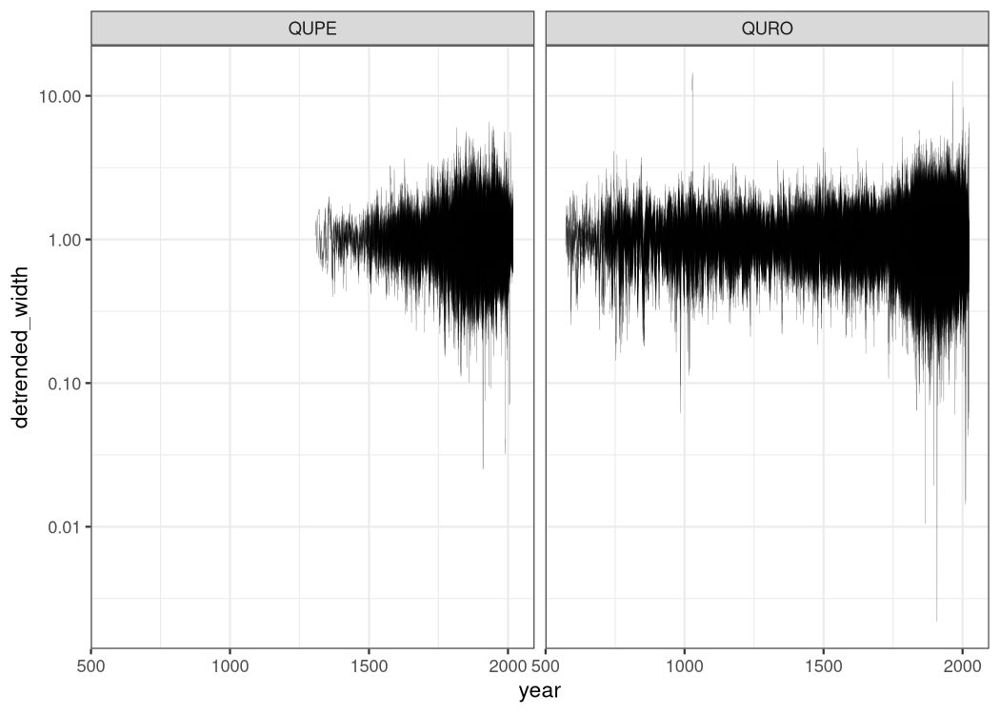

``` r
ggsave("plots/detrended_series.png", width = 9, height = 4, dpi = 150)
```

We still have extreme values, for now we keep everything in and then we
will see …

``` r
# 2. Pivot: years as rows, global_id as columns
# This handles the 2,000 year span and 5,000 series efficiently
wide_series <- dcast(quercus_measurements, year ~ global_id, value.var = "detrended_width")
```

By doing so now we have a fully aligned dataset where na are present for
the series belonging to different times

``` r
# 3. Create the Matrix (drop the 'year' column)
series_mat <- as.matrix(wide_series[, -1])
rownames(series_mat) <- wide_series$year
```

``` r
# 6. Map back to Sets (itrdb_code)
# Create a lookup table for which series belongs to which site
meta_map <- unique(quercus_measurements[, .(global_id, itrdb_code, species)])


quercus_species <- meta_map[match(colnames(series_mat), global_id), species]
matplot(as.numeric(rownames(series_mat)), 
        log10(series_mat), 
        type = "l", 
        col = as.factor(quercus_species), 
        lty = 1)
```

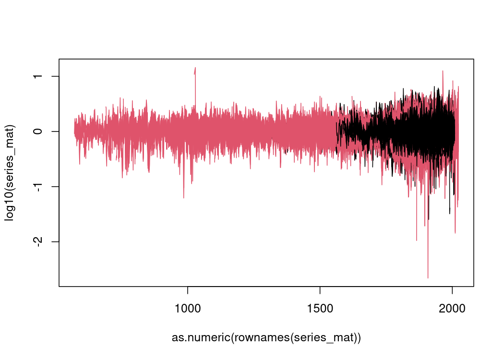

Now we are ready for the calculation of the full correlation matrix

``` r
# 4. Global Correlation Calculation
cor_matrix <- cor(series_mat, use = "pairwise.complete.obs", method = "pearson")

# 5. The Overlap Mask
# 'crossprod' on a logical matrix counts shared non-NA years
overlap_counts <- crossprod(!is.na(series_mat))
cor_matrix[overlap_counts <= 30] <- NA  ## here we fix the minimum overlap to be  considered acceptable
```

We now calculate the correlation within each site.

``` r
within_cors <- meta_map %>%
  as_tibble() %>%
  group_by(itrdb_code) %>%
  summarise(
    species = first(species),
    site_cors = list({
      m <- cor_matrix[global_id, global_id]
      m[upper.tri(m)]
    }),
    .groups = "drop"
  ) 
```

Ok, each site has now a distribution of correlation coefficients, it is
intersting to understand and compare the shapes of the different
distributions. A possible way is to show the positions of the quantiles.

``` r
within_cors <- within_cors %>%
  mutate(
    site_stats = map(site_cors, ~ {
      enframe(quantile(.x, probs = seq(0.05, 0.95, 0.05), na.rm = TRUE))
    })
  ) %>%
  unnest(site_stats) %>%
  pivot_wider(names_from = name, values_from = value)
```

``` r
within_cors %>%
  pivot_longer(cols = ends_with("%"), 
               names_to = "quantile", values_to = "value") %>%
  mutate(quantile = factor(quantile, levels = paste0(seq(5, 95, 5), "%"))) %>%
  ggplot(aes(x = quantile, y = value, group = itrdb_code, color = species)) +
  geom_hline(yintercept = c(0, 0.5), linetype = "dashed", alpha = 0.5) +
  geom_line(alpha = 0.3, lwd = 0.2) +
  geom_point(alpha = 0.3, size = 0.5) +
  ylim(-1, 1) + 
  theme_bw() +
  labs(y = "Correlation Value", x = "Quantile")
```

    Warning: Removed 38 rows containing missing values or values outside the scale range
    (`geom_line()`).

    Warning: Removed 38 rows containing missing values or values outside the scale range
    (`geom_point()`).

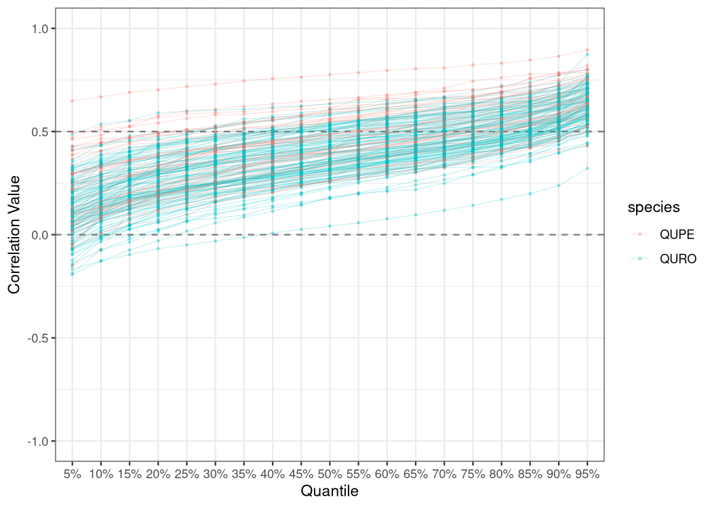

Observations:

- as expected the distribution of the within study correlations is
  always shifted towards positive values
- the steep rise in the correlation for the last segment is most likely
  due to the presence of samples collected on the same tree

We now extract the between sites/study correlations

``` r
between_cors <- expand.grid(
  site_a = unique(meta_map$itrdb_code),
  site_b = unique(meta_map$itrdb_code),
  stringsAsFactors = FALSE
) %>%
  filter(site_a < site_b) %>%
  as_tibble()

between_cors <- between_cors %>%
  mutate(
    cor_values = map2(site_a, site_b, ~ {
      ids_a <- meta_map[itrdb_code == .x, global_id]
      ids_b <- meta_map[itrdb_code == .y, global_id]
      as.vector(cor_matrix[ids_a, ids_b])
    }),
    site_stats = map(cor_values, ~ {
      enframe(quantile(.x, probs = seq(0.05, 0.95, 0.05), na.rm = TRUE))
    })
  ) %>%
  unnest(site_stats) %>%
  pivot_wider(names_from = name, values_from = value)
```

Just for comparison we add the quantiles of the between distributions to
the previous plot

``` r
bind_rows(
  within_cors %>% 
    mutate(type = "Within Site", row_id = row_number()) %>% 
    select(-site_cors, -species, -itrdb_code),
  between_cors %>% 
    mutate(type = "Between Sites", row_id = row_number()) %>% 
    select(-cor_values, -site_a, -site_b)
) %>%
  pivot_longer(cols = ends_with("%"), 
               names_to = "quantile", values_to = "value") %>%
  mutate(quantile = factor(quantile, levels = paste0(seq(5, 95, 5), "%"))) %>%
  ggplot(aes(x = quantile, y = value, color = type, group = interaction(type, row_id))) +
  geom_hline(yintercept = c(0, 0.5), linetype = "dashed", alpha = 0.5) +
  geom_line(alpha = 0.2, lwd = 0.2) +
  scale_color_manual(values = c("Within Site" = "firebrick", "Between Sites" = "steelblue")) +
  facet_wrap(~type) +
  theme_bw() +
  guides(color = guide_legend(override.aes = list(alpha = 1, lwd = 1))) +
  labs(y = "Correlation Value", x = "Quantile", color = "Comparison Type")
```

    Warning: Removed 25688 rows containing missing values or values outside the scale range
    (`geom_line()`).

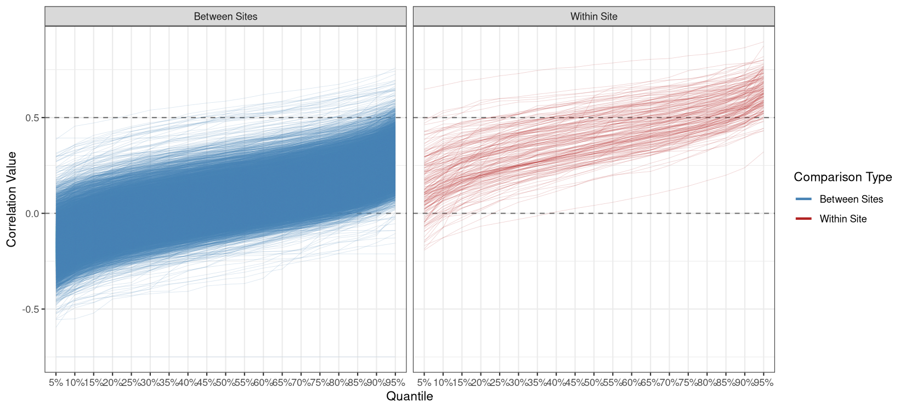

``` r
ggsave("plots/within_between.png", width = 11, height = 5, dpi = 150)
```

    Warning: Removed 25688 rows containing missing values or values outside the scale range
    (`geom_line()`).

The shape of the correlation curves are similar (speaking of similar
distribution) but the distribution of the correlation coefficients is
shifted towards larger correlation values if the site/study is the same.

We now investigate the trend of the quantiles as a function of the
distance between the two sites

``` r
site_coords <- quercus_geo %>%
  group_by(itrdb_code) %>%
  summarise(geometry = st_union(geometry)) %>%
  st_centroid()

dist_matrix <- st_distance(site_coords) / 1000
rownames(dist_matrix) <- site_coords$itrdb_code
colnames(dist_matrix) <- site_coords$itrdb_code

between_cors <- between_cors %>%
  mutate(dist_km = map2_dbl(site_a, site_b, ~ as.numeric(dist_matrix[.x, .y])))
```

``` r
bind_rows(
  between_cors %>%
    mutate(type = "Between") %>%
    select(dist_km, type, ends_with("%")),
  within_cors %>%
    mutate(dist_km = 0, type = "Within") %>%
    select(dist_km, type, ends_with("%"))
) %>%
  pivot_longer(cols = ends_with("%"), names_to = "quantile", values_to = "value") %>%
  mutate(quantile = factor(quantile, levels = paste0(seq(5, 95, 5), "%"))) %>%
  ggplot(aes(x = dist_km, y = value, color = type)) +
  geom_hline(yintercept = c(0, 0.5), linetype = "dashed", alpha = 0.5) +
  geom_point(alpha = 0.1, size = 0.5) +
  facet_wrap(~quantile) +
  scale_x_continuous(transform = "log1p") +
  scale_color_manual(values = c("Between" = "black", "Within" = "red")) +
  theme_bw() +
  labs(x = "Distance (km)", y = "Correlation Value", title = "Correlation Quantiles vs Distance between Sites")
```

    Warning: Removed 25688 rows containing missing values or values outside the scale range
    (`geom_point()`).

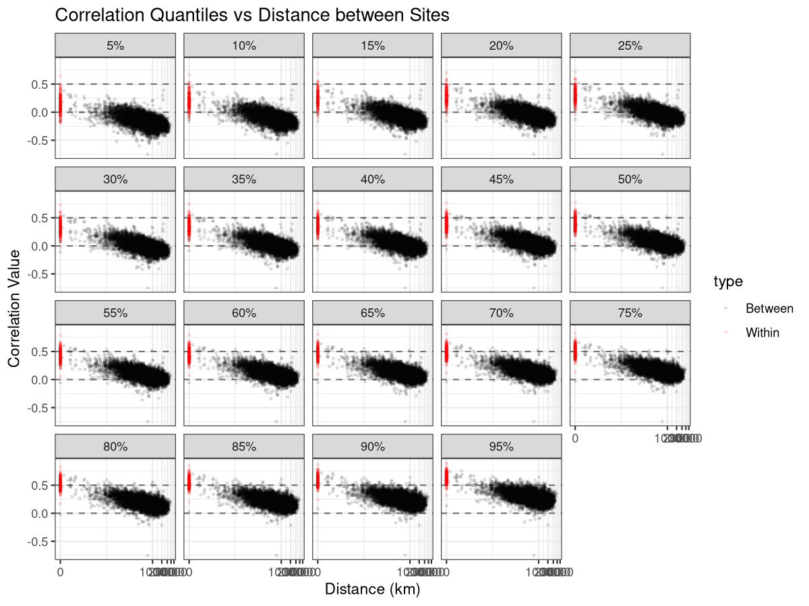

``` r
ggsave("plots/cor_vs_distance.png", width = 8, height = 6, dpi = 150)
```

    Warning: Removed 25688 rows containing missing values or values outside the scale range
    (`geom_point()`).

``` r
# Build the long-form pairwise table (one row per correlation value)
model_df <- between_cors %>%
  select(site_a, site_b, dist_km, cor_values) %>%
  mutate(log_dist = log10(dist_km + 1)) %>%
  unnest(cor_values) %>%
  rename(correlation = cor_values)
```

## Distance Inference from Correlation

Given an observed correlation $r$ between two series of unknown
provenance, we want to estimate the likely geographic distance between
them. The strategy is to model the **empirical quantile envelope** of
the correlation distribution as a smooth function of distance — then
invert: for a given $r$, read off which distances are compatible with it
being a typical (median) or extreme (5th/95th percentile) observation.

The result is an honest **compatibility interval**: the range of
distances for which the observed $r$ is a plausible, non-extreme
outcome. Unlike a full posterior, it makes no claim about the prior
distribution of distances — it only characterises what the data say
about the correlation–distance relationship.

### Step 1: Binned empirical quantiles

Rather than fitting a model directly on the full long-form table of
pairwise correlations, we first summarise into 100 equal-frequency bins
on $\log_{10}(\text{distance})$. With roughly 81k pairs per bin, the
5th, 50th and 95th percentiles within each bin are estimated with
negligible sampling error. Crucially, all data contributes at this stage
— no subsampling.

``` r
binned_quantiles <- model_df %>%
  filter(!is.na(correlation)) %>%
  mutate(dist_bin = cut_number(log_dist, n = 100)) %>%
  group_by(dist_bin) %>%
  summarise(
    log_dist_mid = mean(log_dist),
    dist_km_mid  = 10^mean(log_dist) - 1,
    n            = n(),
    q05 = quantile(correlation, 0.05, na.rm = TRUE),
    q50 = quantile(correlation, 0.50, na.rm = TRUE),
    q95 = quantile(correlation, 0.95, na.rm = TRUE),
    .groups = "drop"
  )
```

The plot below shows the three quantile series as a function of
distance. Each point summarises ~81k pairwise correlations; the decay is
clearly non-linear on the log scale, with the steepest drop at short
distances.

``` r
binned_quantiles %>%
  pivot_longer(cols = c(q05, q50, q95), names_to = "quantile", values_to = "value") %>%
  mutate(
    quantile = recode(quantile, q05 = "5th", q50 = "50th", q95 = "95th"),
    quantile = factor(quantile, levels = c("5th", "50th", "95th"))
  ) %>%
  ggplot(aes(x = dist_km_mid, y = value, color = quantile)) +
  geom_hline(yintercept = 0, linetype = "dashed", alpha = 0.4) +
  geom_point(size = 1.5, alpha = 0.8) +
  scale_x_log10(labels = scales::comma) +
  scale_color_manual(values = c("5th" = "#86b6ef", "50th" = "#2a78d6", "95th" = "#104281")) +
  theme_bw() +
  labs(
    x        = "Distance (km)",
    y        = "Correlation",
    color    = "Quantile",
    title    = "Binned empirical quantiles of correlation vs distance",
    subtitle = "100 equal-frequency bins on log-distance; ~81k pairs per bin"
  )
```

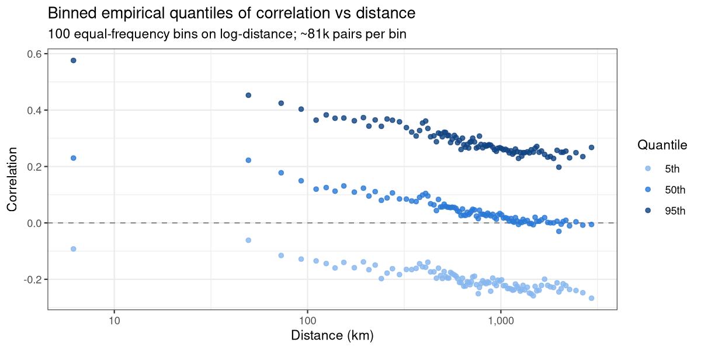

``` r
ggsave("plots/binned_quantiles.png", width = 8, height = 4, dpi = 150)

# Same plot with linear x-axis to show non-linearity in raw distance
binned_quantiles %>%
  pivot_longer(cols = c(q05, q50, q95), names_to = "quantile", values_to = "value") %>%
  mutate(
    quantile = recode(quantile, q05 = "5th", q50 = "50th", q95 = "95th"),
    quantile = factor(quantile, levels = c("5th", "50th", "95th"))
  ) %>%
  ggplot(aes(x = dist_km_mid, y = value, color = quantile)) +
  geom_hline(yintercept = 0, linetype = "dashed", alpha = 0.4) +
  geom_point(size = 1.5, alpha = 0.8) +
  scale_x_continuous(labels = scales::comma) +
  scale_color_manual(values = c("5th" = "#86b6ef", "50th" = "#2a78d6", "95th" = "#104281")) +
  theme_bw() +
  labs(
    x        = "Distance (km)",
    y        = "Correlation",
    color    = "Quantile",
    title    = "Binned empirical quantiles of correlation vs distance",
    subtitle = "100 equal-frequency bins on log-distance; ~81k pairs per bin"
  )
```

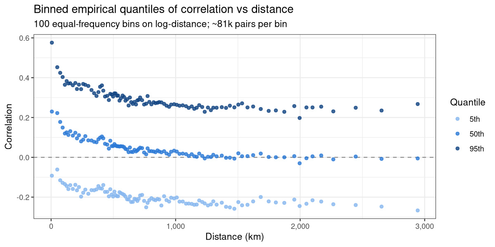

``` r
ggsave("plots/binned_quantiles_linear.png", width = 8, height = 4, dpi = 150)
```

### Step 2: Quantile smoothing

A simple linear model is fitted independently to each of the three
quantile series on the $\log_{10}$ distance scale. This is the most
conservative and interpretable choice: a straight line in $\log_{10}(d)$
corresponds to a log-linear decay of correlation with distance, which is
a well-established empirical pattern in dendroclimatology. Monotonicity
is guaranteed by construction (the slope is negative), and the model has
no tuning parameters.

The key assumption is that the decay is approximately linear on the log
scale across the full distance range. QQ plots of the residuals are used
to assess whether this holds and whether any systematic curvature
remains.

``` r
fit_q05 <- lm(q05 ~ log_dist_mid, data = binned_quantiles)
fit_q50 <- lm(q50 ~ log_dist_mid, data = binned_quantiles)
fit_q95 <- lm(q95 ~ log_dist_mid, data = binned_quantiles)
```

``` r
bind_rows(
  tibble(quantile = "5th",  residuals = residuals(fit_q05)),
  tibble(quantile = "50th", residuals = residuals(fit_q50)),
  tibble(quantile = "95th", residuals = residuals(fit_q95))
) %>%
  mutate(quantile = factor(quantile, levels = c("5th", "50th", "95th"))) %>%
  ggplot(aes(sample = residuals)) +
  stat_qq(size = 1.5, alpha = 0.7) +
  stat_qq_line(color = "steelblue", linewidth = 0.8) +
  facet_wrap(~quantile) +
  theme_bw() +
  labs(
    title    = "QQ plots of linear model residuals",
    x        = "Theoretical quantiles",
    y        = "Sample quantiles"
  )
```

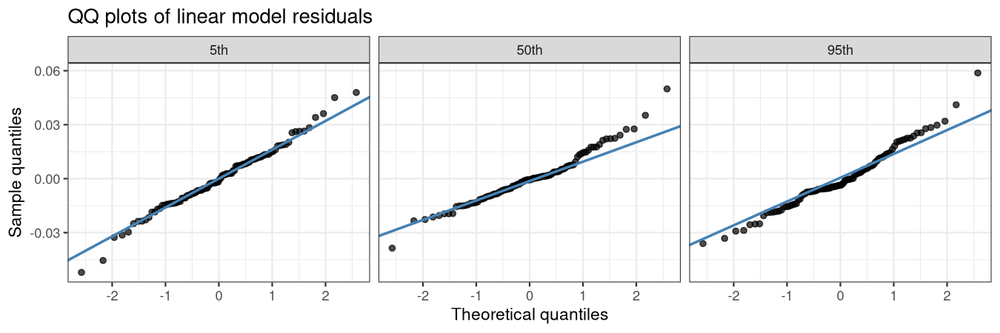

``` r
ggsave("plots/qq_plots.png", width = 9, height = 3, dpi = 150)
```

### Are the three decays parallel?

Rather than pooling all three quantile series into one model with a
quantile:distance interaction — which would need to treat the 300 rows
as independent when in fact the three quantiles are computed from the
same 100 distance bins — we instead compare the confidence intervals of
the slope (and intercept) estimates from the three independently-fitted
models. If the slope CIs overlap substantially, the three log-linear
decays are statistically indistinguishable in steepness, i.e. parallel.

``` r
# Tidy one lm() fit into a long tibble of {term, estimate, 95% CI}, tagged
# with which quantile it belongs to, so the three fits can be bind_rows()'d
# and compared directly (as a table, or by plotting the CIs side by side).
extract_coefs <- function(fit, label) {
  ci <- confint(fit)
  tibble(
    quantile  = label,
    term      = rownames(ci),
    estimate  = coef(fit),
    conf.low  = ci[, 1],
    conf.high = ci[, 2]
  )
}

coef_table <- bind_rows(
  extract_coefs(fit_q05, "5th"),
  extract_coefs(fit_q50, "50th"),
  extract_coefs(fit_q95, "95th")
) %>%
  mutate(
    term     = recode(term, "(Intercept)" = "Intercept", "log_dist_mid" = "Slope (log10 distance)"),
    quantile = factor(quantile, levels = c("5th", "50th", "95th"))
  )

coef_table %>%
  transmute(
    Quantile  = quantile,
    Parameter = term,
    Estimate  = round(estimate, 3),
    `95% CI`  = sprintf("[%.3f, %.3f]", conf.low, conf.high)
  ) %>%
  arrange(Quantile, Parameter) %>%
  knitr::kable(align = "llrr")
```

| Quantile | Parameter              | Estimate |             95% CI |
|:---------|:-----------------------|---------:|-------------------:|
| 5th      | Intercept              |    0.029 |   \[0.005, 0.054\] |
| 5th      | Slope (log10 distance) |   -0.081 | \[-0.090, -0.073\] |
| 50th     | Intercept              |    0.365 |   \[0.346, 0.385\] |
| 50th     | Slope (log10 distance) |   -0.113 | \[-0.120, -0.107\] |
| 95th     | Intercept              |    0.659 |   \[0.636, 0.682\] |
| 95th     | Slope (log10 distance) |   -0.130 | \[-0.138, -0.122\] |

The answer is **no, they are not parallel**: all three slope CIs are
mutually non-overlapping (5th: −0.081 \[−0.090, −0.073\]; 50th: −0.113
\[−0.120, −0.107\]; 95th: −0.130 \[−0.138, −0.122\]), so the decay rate
increases monotonically and significantly from the 5th to the 95th
quantile. The highest-correlation pairs — the most similar chronologies
— lose their similarity fastest with distance, the median decays at an
intermediate rate, and the low tail decays slowest. This is consistent
with high correlations reflecting shared local climate forcing (or, at
very short range, shared trees/samples) that decays quickly, while the
lower and median quantiles already capture broader, slower-varying
regional coherence that persists over longer distances.

The figure below combines the three views into one panel: (A) the binned
quantiles with their linear fits, (B) the slope comparison from above,
and (C) the full coefficient table.

``` r
pred_grid <- tibble(
  log_dist_mid = seq(
    min(binned_quantiles$log_dist_mid),
    max(binned_quantiles$log_dist_mid),
    length.out = 500
  )
) %>%
  mutate(
    dist_km = 10^log_dist_mid - 1,
    q05     = predict(fit_q05, newdata = .),
    q50     = predict(fit_q50, newdata = .),
    q95     = predict(fit_q95, newdata = .)
  )

pred_long <- pred_grid %>%
  pivot_longer(cols = c(q05, q50, q95), names_to = "quantile", values_to = "value") %>%
  mutate(
    quantile = recode(quantile, q05 = "5th", q50 = "50th", q95 = "95th"),
    quantile = factor(quantile, levels = c("5th", "50th", "95th"))
  )

p_linear_fits <- binned_quantiles %>%
  pivot_longer(cols = c(q05, q50, q95), names_to = "quantile", values_to = "value") %>%
  mutate(
    quantile = recode(quantile, q05 = "5th", q50 = "50th", q95 = "95th"),
    quantile = factor(quantile, levels = c("5th", "50th", "95th"))
  ) %>%
  ggplot(aes(x = dist_km_mid, y = value, color = quantile)) +
  geom_hline(yintercept = 0, linetype = "dashed", alpha = 0.4) +
  geom_point(size = 1, alpha = 0.5) +
  geom_line(data = pred_long, aes(x = dist_km, y = value), linewidth = 0.9) +
  scale_x_log10(labels = scales::comma) +
  scale_color_manual(values = c("5th" = "#86b6ef", "50th" = "#2a78d6", "95th" = "#104281")) +
  theme_bw() +
  labs(
    x        = "Distance (km)",
    y        = "Correlation",
    color    = "Quantile",
    subtitle = "Points = binned estimates; lines = linear fit on log₁₀(distance)"
  )

p_slope_ci <- coef_table %>%
  filter(term == "Slope (log10 distance)") %>%
  ggplot(aes(x = estimate, y = quantile, color = quantile)) +
  geom_pointrange(aes(xmin = conf.low, xmax = conf.high)) +
  scale_color_manual(values = c("5th" = "#86b6ef", "50th" = "#2a78d6", "95th" = "#104281")) +
  theme_bw() +
  theme(legend.position = "none") +
  labs(x = "Slope (95% CI)", y = "Quantile")

coef_table_compact <- coef_table %>%
  transmute(
    Quantile  = quantile,
    Parameter = recode(term, "Slope (log10 distance)" = "Slope"),
    Estimate  = round(estimate, 3),
    `95% CI`  = sprintf("[%.3f, %.3f]", conf.low, conf.high)
  ) %>%
  arrange(Quantile, Parameter)

library(patchwork)
library(gridExtra)

# gridExtra::tableGrob renders the data frame as a grid graphical object;
# patchwork::wrap_elements(full = ...) lets that grob sit as an ordinary
# panel alongside the two ggplots below (patchwork has no native table
# geometry, so this is the standard way to embed one).
tg <- tableGrob(
  coef_table_compact, rows = NULL,
  theme = ttheme_minimal(
    base_size = 9,
    core = list(fg_params = list(hjust = 0, x = 0.05)),
    colhead = list(fg_params = list(fontface = "bold"))
  )
)
p_table <- wrap_elements(full = tg)

# patchwork area design: a 2-row x 3-col grid where A (the decay plot) fills
# the left two columns and both rows, while B (slope CI) and C (table) each
# take one cell on the right — so A renders roughly twice the size of B/C.
design <- "
AAB
AAC
"

combined_fig <- p_linear_fits + p_slope_ci + p_table +
  plot_layout(design = design) +
  plot_annotation(
    title = "Correlation decay with distance, by quantile",
    tag_levels = "A"
  )

combined_fig
```

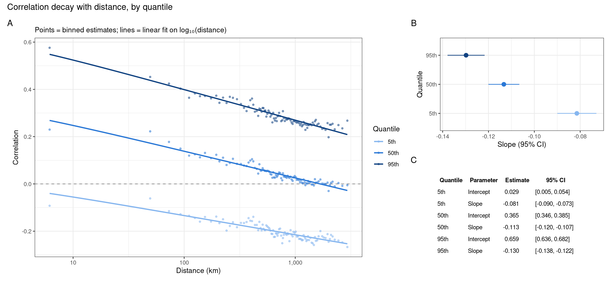

``` r
ggsave("plots/decay_summary_panel.png", plot = combined_fig, width = 13, height = 6, dpi = 150)
```

### Step 3: Distance estimation by inversion

The three linear curves give $Q_\tau(d)$ — the $\tau$-th quantile of the
correlation distribution at distance $d$. To estimate distance from a
query correlation $r$, we invert: for each curve, find the distance at
which the predicted quantile equals $r$.

In practice no explicit root-finding is needed. We predict on a fine
grid of distances, then simply **flip the axes**: plot the predicted
quantile on the x-axis and distance on the y-axis. The median curve
(solid) gives the point estimate; the 5th and 95th curves (dashed) bound
the grey compatibility range — the spread of the correlation
distribution itself at a given distance. On top of that, each of the
three curves also carries its own narrow, colored band: the 95%
confidence interval of *that model’s* coefficients
(`predict(..., interval = "confidence")`). This is a different, much
smaller kind of uncertainty — how precisely that one regression line is
estimated — not to be confused with the (much wider) grey compatibility
range between quantiles.

``` r
## interval = "confidence" gives the CI of the fitted line itself (parameter
## uncertainty from n = 100 bins), not a prediction interval for a new point —
## this is deliberately the "how precisely is this regression line known"
## band, separate from the between-quantile spread computed below.
predict_with_ci <- function(fit, label) {
  pr <- predict(fit, newdata = pred_grid, interval = "confidence")
  tibble(
    quantile = label,
    dist_km  = pred_grid$dist_km,
    fit      = pr[, "fit"],
    lwr      = pr[, "lwr"],
    upr      = pr[, "upr"]
  )
}

pred_ci <- bind_rows(
  predict_with_ci(fit_q05, "5th"),
  predict_with_ci(fit_q50, "50th"),
  predict_with_ci(fit_q95, "95th")
) %>%
  mutate(quantile = factor(quantile, levels = c("5th", "50th", "95th")))

# Reshape to one row per distance with the three quantiles' point estimates
# as columns, so xmin/xmax (the 5th- and 95th-quantile curves) can bound a
# single compatibility ribbon at every distance — this is the honest
# "spread across quantiles" band, distinct from each curve's own model CI.
pred_wide <- pred_ci %>%
  select(quantile, dist_km, fit) %>%
  pivot_wider(names_from = quantile, values_from = fit, names_prefix = "q_")

# geom_ribbon defaults to a vertical band (x fixed, ymin/ymax vary); since
# the chart is flipped (distance on y, correlation on x), orientation = "y"
# tells it to treat y as the continuous axis and xmin/xmax as the band —
# i.e. a horizontal ribbon at each distance, not the default vertical one.
ggplot() +
  geom_ribbon(data = pred_wide, aes(y = dist_km, xmin = q_5th, xmax = q_95th),
              orientation = "y", fill = "orange", alpha = 0.35) +
  geom_ribbon(data = pred_ci, aes(y = dist_km, xmin = lwr, xmax = upr, fill = quantile),
              orientation = "y", alpha = 0.45, color = NA) +
  geom_line(data = pred_ci, aes(x = fit, y = dist_km, color = quantile, linetype = quantile),
            linewidth = 1) +
  scale_linetype_manual(values = c("5th" = "dashed", "50th" = "solid", "95th" = "dashed")) +
  scale_color_manual(values = c("5th" = "#86b6ef", "50th" = "#2a78d6", "95th" = "#104281")) +
  scale_fill_manual(values = c("5th" = "#86b6ef", "50th" = "#2a78d6", "95th" = "#104281")) +
  scale_x_continuous(breaks = seq(-0.5, 1, by = 0.05), minor_breaks = NULL) +
  scale_y_log10(labels = scales::comma,
                breaks  = c(1, 10, 30, 100, 300, 1000, 3000)) +
  theme_bw() +
  theme(panel.grid.major.x = element_line(colour = "grey70", linewidth = 0.3, linetype = "dashed"),
        axis.text.x = element_text(angle = 90, vjust = 0.5, size = 7), aspect.ratio = 1) +
  labs(
    x        = "Pearson correlation",
    y        = "Distance (km, log scale)",
    color    = "Quantile",
    fill     = "Quantile",
    linetype = "Quantile",
    title    = "Estimated distance from correlation (Quercus, ITRDB)",
    subtitle = "Solid = median inversion; dashed = 5th/95th; orange band = compatibility range across quantiles;\ncolored bands = 95% CI of each fitted curve"
  )
```

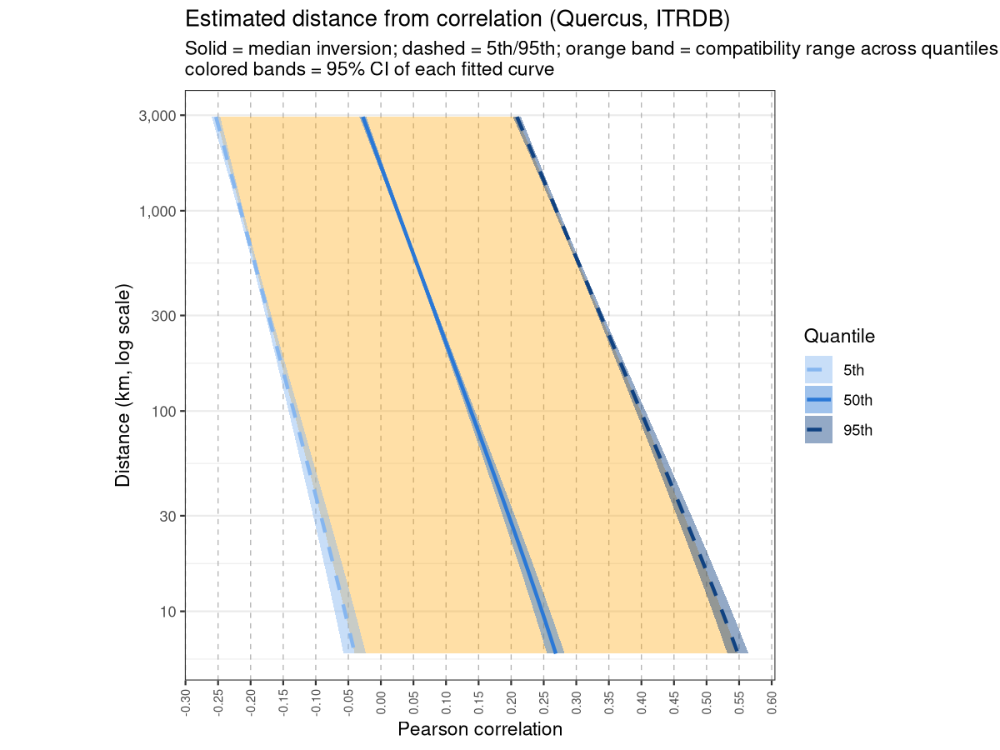

``` r
ggsave("plots/distance_inference.png", width = 8, height = 6, dpi = 150)
```

Observations:

- The decay is non-linear: the steepest distance sensitivity is at short
  ranges (\< 100 km), with the curve flattening at continental scales —
  consistent with a mix of local climate forcing and broad-scale
  atmospheric circulation.
- Within the observed distance range (6–2,944 km), each quantile only
  covers a limited, largely non-overlapping band of correlation values:
  the 5th quantile spans $r \in [-0.25, -0.04]$, the 50th spans
  $[-0.03, 0.27]$, and the 95th spans $[0.21, 0.55]$. A correlation of
  $r = 0.5$, for instance, has a valid inversion *only* on the
  95th-quantile curve (≈ 16 km) — neither the 5th nor 50th quantile ever
  reaches that value at any distance in the data, so the three curves
  cannot meaningfully be compared “apart” at a shared $r$ outside their
  own range.
- Because the three ranges barely overlap, a single observed correlation
  usually falls unambiguously within just one quantile’s band, which is
  itself a consequence of the non-parallel decay established above (see
  “Are the three decays parallel?”): steep separation between quantiles
  means each one is informative over its own distinct slice of the
  correlation axis, rather than the three curves offering competing
  distance estimates for the same $r$.
- The narrow shaded band around each individual line is a different,
  much smaller source of uncertainty: it reflects how precisely *that
  quantile’s own* regression line is estimated (a few hundredths of a
  correlation unit), not the much larger separation between quantiles.
